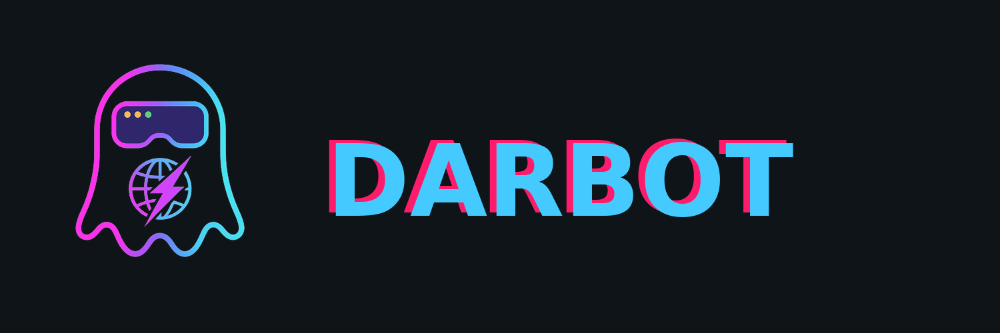

# 🤖 Darbot Browser MCP - VS Code Extension



**Your Autonomous Browser Companion for VS Code**

Transform your coding workflow with intelligent browser automation directly integrated into VS Code. This extension provides seamless access to 34 autonomous browser tools through GitHub Copilot Chat, enabling you to automate web interactions, test applications, and manage browser sessions without leaving your IDE.

[](https://marketplace.visualstudio.com/items?itemName=darbotlabs.darbot-browser-mcp)
[](https://marketplace.visualstudio.com/items?itemName=darbotlabs.darbot-browser-mcp)
[](https://marketplace.visualstudio.com/items?itemName=darbotlabs.darbot-browser-mcp)

---

## [NEW] Features

- **[I18N] Multi-Browser Support** - Edge, Chrome, Firefox, WebKit control
- **📸 Smart Snapshots** - AI-optimized accessibility snapshots  
- **[MOUSE] Browser Interactions** - Click, type, navigate, form filling, drag & drop
- **[FOLDER] Work Profiles** - Save and restore complete browser sessions
- **[CONFIG] Native VS Code Integration** - Seamless MCP server integration with GitHub Copilot Chat
- **[PERF] Real-time Control** - Live browser operations from your IDE
- **🎮 Status Management** - Start/stop server with visual status indicators
- **[TEST] Test Generation** - Generate automated tests from browser interactions
- **[PHONE] Mobile Emulation** - Test responsive designs with device emulation
- **[SHIELD] Professional Grade** - Enterprise-ready with comprehensive error handling

## [TOOLS] Installation

### **Automatic Setup (Recommended)**
1. **Install the extension** from the VS Code marketplace
2. **Choose deployment mode**: On first activation, select:
   - **Local** - Quick NPX setup, no Docker required
   - **Hosted (Docker)** - On-premises with MSAL auth and Dev Tunnels
   - **Cloud (Azure)** - Azure App Service with enterprise features
3. **Auto-configuration**: The extension automatically:
   - Prompts to enable MCP in VS Code settings (`"chat.mcp.enabled": true`)
   - Configures the Darbot Browser MCP server based on your chosen deployment mode
   - Sets up the appropriate connection (NPX command, Docker URL, or Azure URL)
4. **Start using**: The server is ready for GitHub Copilot Chat integration
5. **Test with GitHub Copilot**: Ask Copilot to "take a screenshot of example.com"

### **Manual Setup (Advanced)**
If you prefer manual configuration:
1. Enable MCP in VS Code settings: `"chat.mcp.enabled": true`  
2. Configure the server path in extension settings (defaults to NPM CLI detection)
3. Use the command palette or status bar to start/stop the server

### **What Happens After Installation**
When you first activate the extension:
- [CONFIG] **Auto-detects MCP availability** and prompts to enable if needed
- [GEAR] **Auto-configures the MCP server** in your VS Code settings (`chat.mcp.servers`)
- [CHART] **Adds status bar indicator** showing server state (Running/Stopped)
- [DEPLOY] **Ready to use** with GitHub Copilot Chat immediately
- [TIP] **Shows helpful prompts** to restart VS Code or start the server

## 🎮 Usage Examples

**With GitHub Copilot Chat:**
```
👤 "Take a screenshot of example.com"
🤖 I'll navigate to example.com and capture a screenshot for you.

👤 "Navigate to example.com and click the More information link"  
🤖 I'll navigate and locate the "More information..." link to click.

👤 "Save this browser session as 'research-profile'"
🤖 I'll save the current browser state as work profile 'research-profile'.

👤 "Fill out the contact form with test data"
🤖 I'll fill the contact form with appropriate test data.

👤 "Generate an automated test for the login flow"
🤖 I'll create an automated test based on the current page interactions.
```

**Direct Commands:**
- `Ctrl+Shift+P` -> "Darbot Browser MCP: Start Server"
- Use status bar indicator to monitor server health
- Configure browser preferences in VS Code settings

## Configuration

### Deployment Mode Settings
- `darbot-browser-mcp.deploymentMode`: Choose deployment mode (default: `local`)
  - **local** - Run via NPX (npx @darbotlabs/darbot-browser-mcp@latest)
  - **hosted** - Docker container with MSAL auth and Dev Tunnels
  - **cloud** - Azure App Service with enterprise features
- `darbot-browser-mcp.serverPath`: Path or command for Local mode (default: `npx @darbotlabs/darbot-browser-mcp@latest`)
- `darbot-browser-mcp.hostedUrl`: URL for Hosted mode Docker instance (default: `http://localhost:8080`)
- `darbot-browser-mcp.cloudUrl`: Azure App Service URL for Cloud mode (e.g., `https://your-app.azurewebsites.net`)

### General Settings
- `darbot-browser-mcp.autoStart`: Automatically start the server when VS Code starts (default: `false`)
- `darbot-browser-mcp.autoConfigureMCP`: Automatically configure MCP settings when first activated (default: `true`)
- `darbot-browser-mcp.logLevel`: Log level for the server (error, warn, info, debug) (default: `info`)

### Advanced Configuration

You can also configure the server with additional arguments by modifying the `serverPath` setting:

```json
{
  "darbot-browser-mcp.serverPath": "npx @darbotlabs/darbot-browser-mcp@latest --headless --device 'iPhone 15'"
}
```

Common configuration options:
- `--headless`: Run browser in headless mode
- `--device "iPhone 15"`: Emulate mobile devices
- `--isolated`: Use isolated browser sessions
- `--vision`: Enable vision mode for screenshot-based interactions

## Commands

- `Darbot Browser MCP: Configure Deployment Mode`: Choose between Local, Hosted, or Cloud deployment
- `Darbot Browser MCP: Start Server`: Start the Browser MCP server (Local mode only)
- `Darbot Browser MCP: Stop Server`: Stop the Browser MCP server (Local mode only)
- `Darbot Browser MCP: Restart Server`: Restart the Browser MCP server (Local mode only)
- `Darbot Browser MCP: Show Status`: Show server status and deployment configuration

## [CONFIG] Requirements

- **Node.js**: Version 18.0.0 or higher
- **VS Code**: Version 1.95.0 or higher
- **Browser**: Microsoft Edge (recommended) or Chrome/Firefox/WebKit
- **MCP Support**: Enable `"chat.mcp.enabled": true` in VS Code settings

## [BUG] Troubleshooting

**Extension not loading?**
- Check VS Code Developer Console (`Ctrl+Shift+I`)
- Verify Node.js 18+ is installed
- Ensure MCP is enabled in settings

**Browser automation failing?**
- Confirm Microsoft Edge is installed
- Check firewall/antivirus blocking browser automation
- Try disabling sandbox mode in extension settings

**MCP server not discovered?**
- Restart VS Code after installation
- Use Command Palette: "MCP: Show Installed Servers"
- Check extension status in "Extensions" panel
- If you prefer manual setup, disable auto-configuration: `"darbot-browser-mcp.autoConfigureMCP": false`

## 📄 License

Apache License 2.0 - see [LICENSE](https://github.com/darbotlabs/darbot-browser-mcp/blob/main/LICENSE) for details.

## 🔗 Links

- **[GitHub Repository](https://github.com/darbotlabs/darbot-browser-mcp)** - Source code and documentation
- **[Issues & Support](https://github.com/darbotlabs/darbot-browser-mcp/issues)** - Bug reports and feature requests
- **[Darbot Labs](https://github.com/darbotlabs)** - More AI automation tools

---

*** If this extension helps your workflow, please rate it on the marketplace!**

**Made with <3 by Darbot Labs**